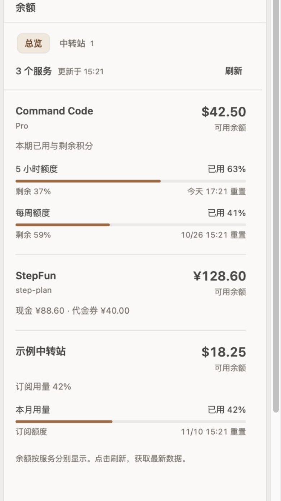
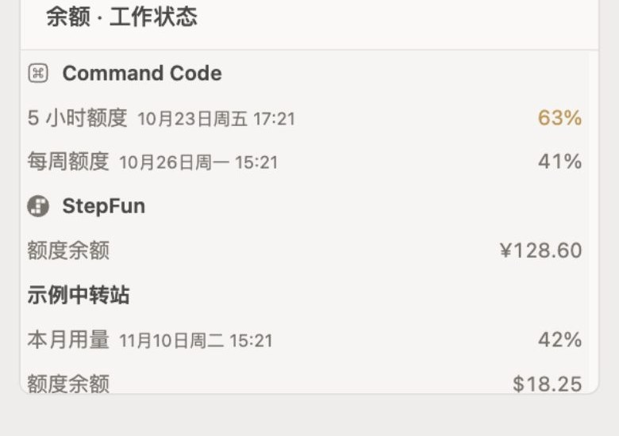

# openchamber-balance

English | [简体中文](#简体中文)

## English

**Balance** brings AI service balances, quotas and reset times into one side panel and a compact Work Status section. It supports Command Code, StepFun and custom relay endpoints, keeps the last successful result when a refresh fails, and uses manual refresh instead of background polling.

### Highlights

- Command Code, StepFun and custom relay balances in one overview.
- Used quota, remaining quota and reset time; amounts are right-aligned and currencies stay separate.
- Relay management with a connection test before saving.
- Cached results, merged concurrent refreshes and immediate cache invalidation after a relay change.
- Light, dark and narrow layouts that follow the host theme.

### Screenshot



*Synthetic preview with sample providers. No real account, credential or key is used.*



*The compact Work Status section.*

### Install

In OpenChamber, open **Settings → Extensions → Add extension** and paste:

```text
https://github.com/chenyuhao0628/openchamber-balance
```

Requires OpenChamber **1.24.0 or newer**; tested on 2.5.0. The extension runs a local service on `127.0.0.1` and checks the host Bearer token. Saved relay keys are never returned by the list or balance APIs.

> The panel UI is currently Chinese. The full Chinese documentation is below.

---

## 简体中文

OpenChamber 余额扩展，在**工作状态分区**与右侧「**余额**」面板中汇总 AI 服务的余额、额度和重置时间。

当前版本 **0.2.9**，本说明于 **2026-10-22** 对照源码和本机宿主核对。清单声明宿主版本 `>=1.24.0`，SDK 依赖为 **2.5.0**；这些声明不等于已测试所有宿主版本。

## 使用体验

0.2.9 将工作状态分区对齐宿主内置「用量」：刷新与管理进入分区标题行，正文改为紧凑行式布局，使用 13px 标签/数值和 28px 行高，去掉大号金额、卡片边框与进度条。完整侧栏面板保持原有总览与中转站管理。

0.2.2 进一步接入项目共享的 `ui/native.css`，统一基础主题、焦点、字号与减少动画规则；图标使用宿主已支持的 `bank-card`，避免未识别图标回退为默认扩展图标。业务接口和服务逻辑保持上一版行为。

- 默认打开「总览」：服务名称、余额、已用额度与重置时间按固定层次展示，金额右对齐；不同币种分别显示。
- 「中转站」独立管理连接，点击添加或编辑才出现表单，保存后返回总览。
- 跟随 OpenChamber 的字体、色彩和控件风格，适配浅色、深色和窄侧栏。方向键可切换页签，Enter 可提交表单。
- 工作状态分区与内置「用量」使用同一套标题行和行式布局，刷新/管理位于标题行；管理入口复用完整余额侧栏。无项目会话可直接点击右侧「余额」图标；原版宿主 2.4.0 的工作状态「管理」入口仍无响应，该限制暂时保留，原因见[已知限制](#已知限制)。
- 刷新失败时保留上次成功数据，并明确显示“上次余额”、错误原因和成功时间；未知余额显示 `—`。

工作状态分区的结构、字体、图标、数据顺序和宿主 iframe 限制见[工作状态分区 UI 规范](STATUS-SECTION.md)。

## 支持的数据

| 供应商 | 当前实现的数据来源 | 展示内容 |
| --- | --- | --- |
| Command Code | `whoami`、`billing/credits`；补充查询 `billing/subscriptions` 与 `usage/summary` | 剩余积分、5 小时/每周额度；数据完整时展示推算的月度使用比例及套餐 |
| StepFun（含 step-plan） | `GET https://api.stepfun.com/v1/accounts` | 总余额、现金和代金券余额 |
| 自定义中转站 | 依次识别 `/v1/usage`、dashboard billing、`/api/usage/token/` | 接口可提供的余额、订阅或用量信息 |

当前源码**没有内置 OpenCode Go 查询**。Command Code 的月度总额由本期已用与剩余积分相加得到，不应解读成供应商明确返回的固定套餐额度。中转站兼容性取决于实际返回字段，详见本页“支持的数据”与“凭据如何使用”。

没有可用凭据的内置供应商不展示；已配置但查询失败的供应商单独显示错误，不阻止其他供应商显示。

## 安装与重载

### 从 GitHub 安装（可自动更新）

在 OpenChamber **设置 → 扩展 → 添加扩展** 中粘贴：

```text
https://github.com/chenyuhao0628/openchamber-balance
```

设置页会按仓库根 `package.json` 的 `version` 检查更新。有新版本时，卡片会显示「更新」。只有 Git URL 安装会自动更新；文件夹和 zip 安装需要手动替换。

### 从文件夹安装（开发）

首次检出源码后，先在本扩展目录执行 `npm ci`、`npm run typecheck` 和 `npm test` 生成面板与服务脚本，再安装：

1. 在 OpenChamber 的 **设置 → 扩展** 中选择从文件夹添加。
2. 选择此 `openchamber-balance` 目录。
3. 按宿主提示授权本地服务；服务以当前用户权限运行。
4. 打开「余额」侧栏，或查看工作状态中的「余额」分区。

本机已验证的界面重载入口为 **OpenChamber 菜单 → 重新加载界面**。它只重载界面，可能保留旧本地服务。服务代码更新后，在 **设置 → 扩展 → 余额** 中先禁用、再启用，然后重新加载界面；本次按此方式加载了 v0.2.0 的界面和服务。`npm run watch` 只负责构建，不自动重启宿主服务。

卸载从宿主扩展设置中移除，配置数据的清理应另行确认。

## 刷新方式

- **没有定时自动刷新。** 服务进程第一次收到余额请求时查询上游，随后缓存结果；切换会话或再次打开面板复用缓存。
- 点击「刷新」会强制查询；同一配置版本下的并发查询会合并，刷新过程中保留已有结果。
- 保存或移除中转站时，服务立即使缓存失效，旧的进行中请求也不能重新带回旧配置；该面板随后重新查询余额。
- 服务重启会丢失内存缓存。各面板没有实时广播同步，其他已打开面板需要再次加载或点击刷新。
- 直接编辑磁盘配置后，应重新加载扩展服务；文件没有自动监听，重启还会清除旧账户的历史余额。

## 管理中转站

在右侧「余额」面板切换到「中转站」。工作状态分区只显示摘要，不提供管理表单。

- **新增**：点击「添加中转站」，填写名称、服务地址和 API Key。可先「测试连接」；测试会请求上游，成功提示中明确说明尚未保存。
- **编辑**：Key 留空表示继续使用已保存的 Key。如果更换协议、主机或端口，需填写新站点的 Key，避免把原 Key 发往其他站点。
- **移除**：点击「移除」后就地确认，可取消。确认后删除本地配置项并更新余额列表。
- **服务地址**：接受 `relay.example.com`、`https://relay.example.com` 或 `https://relay.example.com/v1/`，统一为 `https://relay.example.com`；自定义代理路径保留。地址不能包含账号密码、查询参数或锚点。
- **草稿**：切换页签或主题保留正在输入的内容；保存成功或取消会清空表单中的 Key。关闭或重载界面不保留草稿。

也可手动维护 `~/.config/openchamber/balance/config.json`，结构如下；这里的 Key 只是占位符：

```json
{
  "relays": [
    {
      "id": "relay-example",
      "name": "示例中转站",
      "baseUrl": "https://relay.example.com",
      "apiKey": "REPLACE_WITH_YOUR_API_KEY"
    }
  ]
}
```

服务写入配置时通过临时文件原子替换，文件权限为 `0600`。配置损坏或无法读取时会报错，不会静默覆盖为一个空列表。手工创建文件时需自行确保相同权限。

## 凭据如何使用

Command Code 和 StepFun 优先从 OpenCode SQLite 凭据表只读加载；数据库不可用时尝试旧版 `auth.json`。自定义中转站使用上面的本地配置文件。

服务不会通过列表和余额接口回传已保存的 Key，只返回 `hasKey` 等元数据。用户新输入的 Key 会暂时存在于面板表单中，再经宿主代理提交给本地服务；供应商请求由服务执行。不要将这个设计描述为“面板永远接触不到密钥”。

## 已知限制

- 无项目会话中，工作状态「管理」入口可能无响应；请直接点击右侧「余额」图标。
- 项目路径含中文等字符时，宿主文件请求可能失败；可改用无项目会话。

## 开发

在本扩展目录执行：

```sh
npm ci
npm run typecheck
npm test
```

| 源文件 | 职责/产物 |
| --- | --- |
| `src/panel/main.ts` / `style.css` | 双入口的交互与宿主主题样式 |
| `src/panel/data.ts` / `format.ts` | 防御性响应解析、金额与日期格式化 |
| `src/service/main.ts` / `cache.ts` | 本地服务、供应商适配、配置及缓存失效 |
| `src/shared/` | 共享数据类型、地址规范化 |
| `panel/index.html` / `panel/section.html` | 两种面板入口 |
| `scripts/build.mjs` | esbuild 构建与 watch 模式 |
| `package.json` 的 `openchamber` 字段 | panel、statusSection、service 清单 |
| `tests/` | Node 单元测试和隔离 HTTP 集成测试 |

`npm test` 自动先构建，再运行 21 项回归测试；单独构建使用 `npm run build`，持续构建使用 `npm run watch`。`npm run preview` 只在 `127.0.0.1` 服务构建产物，使用合成供应商数据，不读取真实凭据或余额。CSS 编译进两份面板脚本，不依赖外部样式网络请求。

构建以退出码为准：失败时旧产物可能仍存在。完整的修改、验证、版本与重载步骤见本页“开发”与“安装与重载”。

## License

MIT. See [LICENSE](LICENSE).

返回[本仓库首页](README.md)。
